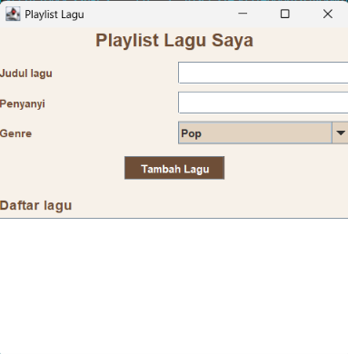
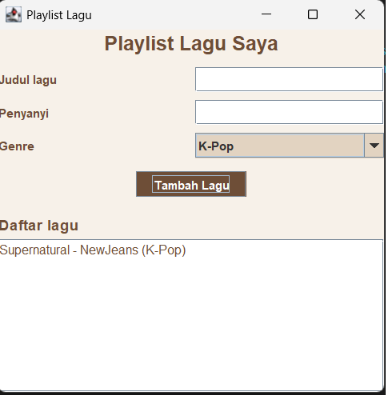

## Komponen Utama GUI

### 1. Top-Level Container Class
**Class: `JFrame`**

Pada program ini, `JFrame` menjadi tempat untuk menampilkan seluruh komponen Playlist Lagu.

### 2. Intermediate Container Class
**Class: `JPanel`**

Contoh `JPanel` dalam program, panel input digunakan untuk mengatur label, kolom input, dan pilihan genre.

### 3. Atomic Component Class

- `JLabel`: menampilkan teks seperti judul aplikasi, judul lagu, penyanyi, dan genre.
- `JTextField`: tempat memasukkan judul lagu dan nama penyanyi.
- `JComboBox`: menyediakan pilihan genre lagu.
- `JButton`: tombol untuk menambahkan lagu ke playlist.
- `JTextArea`: menampilkan daftar lagu yang sudah ditambahkan.
- `JScrollPane`: membantu menggulir daftar lagu jika isinya semakin banyak.

### 4. Layout Classes

- `BorderLayout`: membagi panel menjadi beberapa bagian, seperti atas dan tengah.
- `GridLayout`: menyusun label dan kolom input dalam bentuk baris dan kolom.

### 5. Event Listener
**Interface: `ActionListener`**

`ActionListener` Pada program ini digunakan pada `actionPerformed()` yang dijalankan ketika tombol **Tambah Lagu** diklik.

## Screenshot Aplikasi

